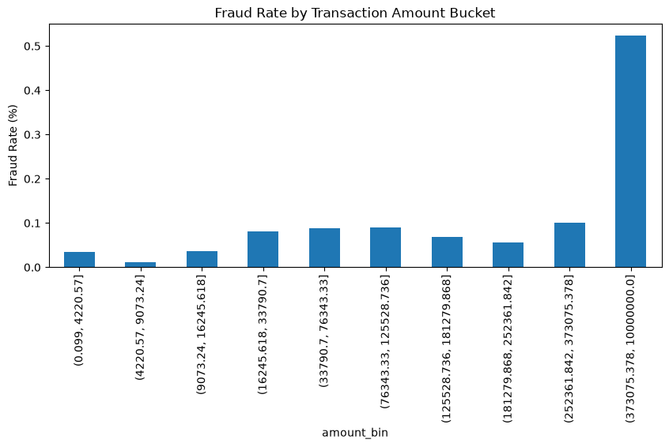
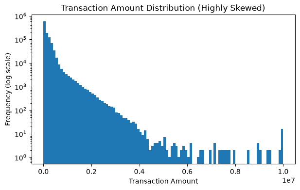
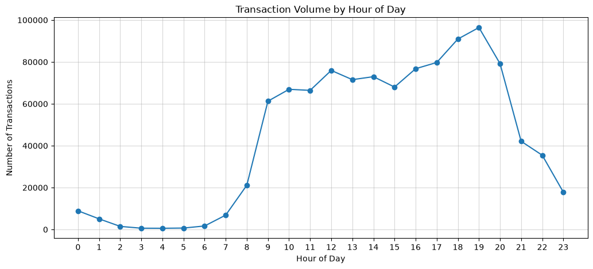
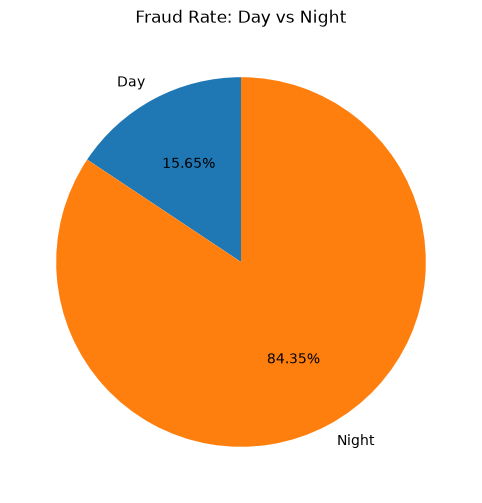
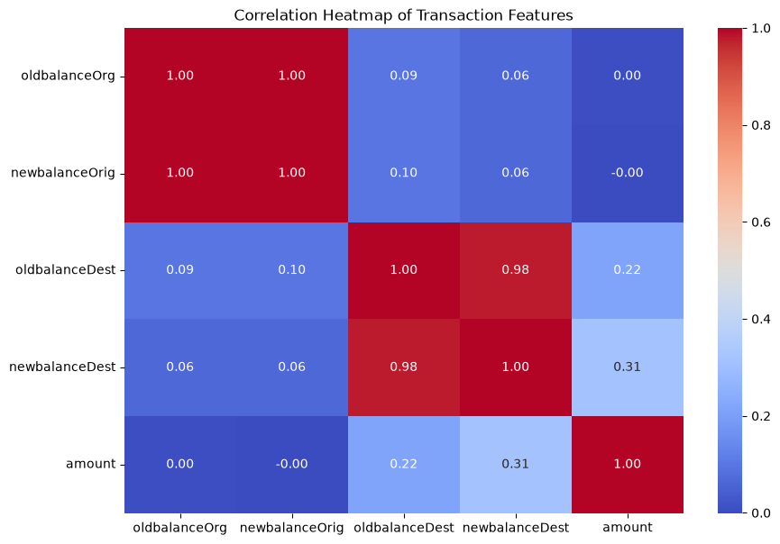

# Bank Fraud Detection Using Machine Learning

### Turning Transaction Data into Actionable Fraud Prevention Insights

**Author:** Wycliffe Adek  
**Project:** Bank Fraud Detection  
**Technologies:** Python | Pandas | NumPy | Matplotlib | Seaborn | Scikit-learn | XGBoost

---

## 1. About the Author

I am **Wycliffe Adek**, a data analyst with an academic background in Applied Statistics and experience in data analysis and monitoring and evaluation.

I am passionate about transforming raw data into meaningful insights that support better decision-making. My interests include statistical analysis, machine learning, predictive modelling and business analytics.

This project demonstrates the application of data analytics and machine learning to a real-world financial challenge: detecting potentially fraudulent transactions.

---

## 2. Project Overview

Financial fraud is a significant challenge for banks and financial institutions. Fraudulent transactions can result in financial losses, undermine customer confidence and expose institutions to operational risks.

This project focuses on analysing financial transaction data, identifying patterns associated with fraudulent activities and developing machine learning classification models to support fraud detection.

The project follows a data analysis and machine learning workflow, from data preparation and exploratory analysis to model development, evaluation and business recommendations.

## 3. Project Objectives

- Clean and prepare transaction data for analysis.
- Explore transaction patterns and identify unusual behaviour.
- Examine relationships between variables and potential fraud indicators.
- Develop and compare machine learning classification models.
- Evaluate model performance using appropriate metrics.
- Identify important predictors of fraudulent transactions.
- Recommend practical fraud prevention and monitoring strategies.

---

## 4. Explore the Project

Access the project materials directly from the links below.

| Project Resource | Description |
|---|---|
| [Jupyter Notebook](./Analysis1.ipynb) | Complete analysis and machine learning workflow |
| [Charts and Visualizations](./images/) | Explore the generated charts |
| [Data Tables and Results](./tables/) | Access exported CSV files |
| [Trained Machine Learning Model](./models/) | Access the saved model |
| [Requirements](./requirements.txt) | Python dependencies |

---

## 5. Exploratory Data Analysis

Exploratory Data Analysis (EDA) was conducted to understand the transaction data and identify patterns that could help distinguish fraudulent transactions from legitimate ones.

The analysis explores:

- Distribution of fraudulent and legitimate transactions.
- Transaction amount patterns.
- Relationships between transaction variables.
- Correlation analysis.
- Unusual transaction behaviour.
- Potential indicators of fraudulent activities.

**Explore the analysis charts:** [Open the images folder](./images/)

### Visual Analysis Gallery

Click any chart to view it in full size.

#### 1. Fraud Rate by Transaction Amount

[](./images/01_fraud_rate_by_amount_bucket.png)

#### 2. Outlier Handling

[](./images/02_outlier_handling.png)

#### 3. Fraud Rate by Transaction Type

[](./images/03_fraud_rate_by_transaction_type.png)

#### 4. Time-Based Overview — Chart 1

[](./images/04_time-based_overview.png)

#### 5. Time-Based Overview — Chart 2

[](./images/05_time-based_overview.png)

#### 6. Time-Based Overview — Chart 3

[](./images/06_time-based_overview.png)

#### 7. Correlation Check

[](./images/07_correlation_check.png)

**More analysis outputs:** [Explore all charts](./images/) | [Explore exported tables](./tables/)

**Explore the exported results:** [Open the tables folder](./tables/)

---

## 6. Machine Learning Approach

This project applies supervised machine learning classification techniques to predict potentially fraudulent transactions.

The models explored include:

1. Logistic Regression
2. Random Forest
3. XGBoost

The modelling workflow covers:

- Data preparation and preprocessing.
- Feature selection and preparation.
- Model training.
- Model comparison.
- Prediction and classification.
- Model performance evaluation.

### Model Evaluation

Fraud detection datasets are often highly imbalanced. This means fraudulent transactions may represent only a very small proportion of all transactions.

For this reason, accuracy alone is not sufficient to evaluate a fraud detection model.

The evaluation considers:

- Precision
- Recall
- F1-score
- ROC-AUC
- Precision-Recall AUC
- Confusion Matrix

The final performance results should be interpreted using an independent test dataset.

---

## 7. Business Recommendations

Machine learning predictions can support financial institutions in strengthening their fraud prevention processes.

Potential recommendations include:

**1. Real-time transaction monitoring**  
Flag suspicious transactions for further review.

**2. Risk-based authentication**  
Apply additional verification to transactions with elevated fraud risk.

**3. Fraud investigation**  
Prioritize suspicious transactions for investigation.

**4. Continuous model monitoring**  
Monitor false positives, missed fraud cases and changes in transaction behaviour.

**5. Model improvement**  
Regularly validate and update models as new transaction data becomes available.

---

## 8. Project Structure

```text
bank-fraud-detection/
│
├── images/
│   └── Analysis charts
│
├── tables/
│   └── Exported CSV tables
│
├── models/
│   └── Trained fraud detection model
│
├── Analysis1.ipynb
├── requirements.txt
├── .gitignore
└── README.md
```

---

## 9. Technologies Used

| Technology | Application |
|---|---|
| Python | Main programming language |
| Pandas | Data manipulation and analysis |
| NumPy | Numerical computations |
| Matplotlib | Data visualization |
| Seaborn | Statistical visualization |
| Scikit-learn | Machine learning and evaluation |
| XGBoost | Gradient boosting classification |
| Jupyter Notebook | Interactive analysis |

---

## 10. How to Run the Project

Clone the repository:

```bash
git clone https://github.com/Adek321/bank-fraud-detection.git
```

Navigate to the project directory:

```bash
cd bank-fraud-detection
```

Install the dependencies:

```bash
pip install -r requirements.txt
```

Launch the notebook:

```bash
jupyter notebook Analysis1.ipynb
```

**Dataset note:** The original transaction dataset is not included in this repository. An authorized copy of the dataset is required to reproduce the analysis. Configure the correct dataset path in the notebook before running it.

---

## 11. Limitations and Future Improvements

Future improvements may include:

- Further validation of the final model on an independent test dataset.
- Investigating false-positive predictions.
- Exploring additional feature engineering techniques.
- Testing alternative classification algorithms.
- Developing an interactive fraud monitoring dashboard.
- Deploying the model through an application programming interface.
- Monitoring model performance as transaction patterns change.

---

## 12. Author and Contact

**Wycliffe Adek**  
Data Analyst | Applied Statistics | Machine Learning | Business Analytics

**GitHub:** [Adek321](https://github.com/Adek321)

**Project Repository:** [Bank Fraud Detection](https://github.com/Adek321/bank-fraud-detection)

---

*Transforming Data into Decisions.*
